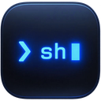
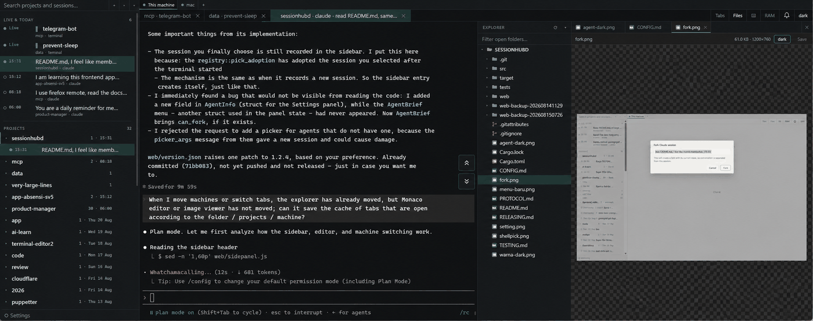

# sessionhub



sessionhub keeps coding-agent terminals alive in a daemon and makes them
available in a browser. Close the browser, switch computers, or check from a
phone; the agent keeps running.

It has been tested with Claude Code, Codex CLI, opencode, and Oh My Pi. There
is no chat layer or task manager: the main interface is the agent's own
terminal.



## Why

I wanted agent sessions to survive a closed laptop and remain usable from a
phone. sessionhub does that with a daemon that owns the PTYs and a browser page
that connects to them. It passes terminal bytes through unchanged and uses each
CLI's existing session registry, so old sessions remain available to resume.

[T3 Code](https://betterstack.com/community/guides/ai/t3-code/) is a better fit
for a task/chat workflow. [herdr](https://herdr.dev/) is a better fit for a
terminal TUI over SSH. sessionhub is for using the agent's raw terminal from a
browser.

## Features

- Sessions survive the browser closing
- Raw PTY passthrough with no prompt injection
- Resume and fork sessions created inside or outside sessionhub
- Saved terminals that start with the daemon
- Several machines in one window; remote tokens stay on the daemon
- Phone controls for Esc, Enter, Shift+Tab, Ctrl, arrows, paste, and uploads
- Busy/finished status, finish chime, tab colours, CPU, and RAM usage
- Monaco file panel with drag-and-drop and paste uploads
- Self-update and Cloudflare access from Settings
- One binary with no frontend build step

| Shortcut | Action |
|---|---|
| `Ctrl/Cmd+K` | command palette |
| `Ctrl/Cmd+B` | hide/show the sidebar |
| `Ctrl/Cmd+1..9` | switch to the nth terminal |
| `Ctrl/Cmd+W` | close the tab; the terminal keeps running |
| `Ctrl/Cmd+Shift+W` | kill the terminal, with confirmation |

Every other key goes to the agent untouched.

## Install and run

Download the binary from
[Releases](https://github.com/goldalworming/sessionhub/releases/latest) and run
it. The macOS release includes an unsigned `.app`; open it the first time with
right-click → Open. The Linux x86_64 build is statically linked with musl.

To build from source, install stable Rust and run `cargo build --release`.

```text
sessionhubd start          # start the daemon and open the browser
sessionhubd status         # show address, uptime, and live terminals
sessionhubd stop
sessionhubd restart        # stop and start again
```

`start` prints a tokenized address. After the first open, a cookie keeps that
device signed in. Run `start` again to print the address again. The tray or menu
bar icon also provides the address, log, and stop action.

`restart` ends every live terminal, so it refuses to run while terminals are
active unless you pass `--force`.

## Access from outside

Use **Settings → Cloudflare** to expose sessionhub or another local service
through a Cloudflare tunnel. For LAN access, use **Settings → Network access**.
See [CONFIG.md](CONFIG.md#access-from-outside) for setup and pairing.

> **This exposes a shell.** Anyone with the address and token can run commands
> as you. Use Cloudflare Access or another authentication layer for internet
> access. If a URL leaks, rotate the token in **Settings → Network access → New
> token** or run `sessionhubd token rotate`.

On a public server, leave Network access off so sessionhub stays on
`127.0.0.1:7717`. Put a Cloudflare tunnel or TLS reverse proxy in front of it.
Serve sessionhub at the root of a hostname, not a subpath. Reverse proxies must
support WebSocket upgrades and long-lived connections.

On Windows, **Settings → Machines → Open locally** makes this machine's own
tunnel hostname (`https://sbox.example.com`) open straight from this machine,
without the round trip through Cloudflare. It points the name at 127.0.0.1 in
the hosts file, trusts a certificate made on the spot, and serves https on
`127.0.0.1:443` — one administrator prompt. It stays https, so the clipboard
keeps working; other devices still go through the tunnel. **Turn off** removes
the hosts line and the certificate.

## Using another machine

A paired machine can run commands and transfer files:

```text
sessionhubd machines
sessionhubd run  --on NAME [--cwd DIR] [--timeout S] -- COMMAND…
sessionhubd push --on NAME <local-file> <remote-path>
sessionhubd pull --on NAME <remote-path> <local-file>
```

`run` forwards stdout and stderr and exits with the remote command's exit code.
`push` and `pull` transfer one file at a time. Use an archive for a directory.

To tell an agent about these commands, add this to the project's `CLAUDE.md`:

> This machine can reach other computers through sessionhub. `sessionhubd
> machines` lists them; `sessionhubd run --on NAME -- COMMAND` runs a command
> there and returns its exit code; `sessionhubd push` and `pull` move one file.

Remote commands are controlled by **Settings → Network access → Remote
commands** and are logged on the machine that runs them. See
[CONFIG.md](CONFIG.md#running-commands-there) for pairing, security, and tunnel
setup.

## Scripted control

A script or another program on the same machine, such as a workflow engine or
a build step, can create and drive an agent terminal without anyone opening it
in the browser first. The terminal is a normal terminal: it appears live in
the browser right away, and you can type into it there at the same time.

```text
sessionhubd spawn --agent omp --project ~/code/demo --name builder
sessionhubd send builder --file task.md
sessionhubd wait builder --idle 20 --timeout 1800
sessionhubd capture builder
```

### Commands

```text
sessionhubd ls [--json]
sessionhubd spawn --agent NAME --project DIR [--resume ID] [--name LABEL] [--env NAME=VALUE | --env NAME]... [--on MACHINE]
sessionhubd send <id-or-name> [TEXT | --file PATH] [--enter] [--key NAME]... [--from LABEL] [--raw] [--verify] [--on MACHINE]
sessionhubd capture <id-or-name> [--lines N] [--raw] [--json] [--on MACHINE]
sessionhubd wait <id-or-name> [--idle S] [--timeout S] [--on MACHINE]
```

| Command | What it does |
|---|---|
| `ls` | Lists live terminals with their id, name, agent, project, and status. |
| `spawn` | Starts a terminal and prints its id on stdout, so `id=$(sessionhubd spawn ...)` works in a script. |
| `send` | Sends text to a terminal. The text comes from a trailing argument, `--file`, or stdin. |
| `capture` | Prints the terminal's current screen as plain text, with ANSI codes removed. |
| `wait` | Blocks until the terminal has been quiet for `--idle` seconds or its process has exited. |

Options:

- `spawn --name LABEL` gives the terminal a label that other commands can use
  instead of the id. The label lasts only while the terminal is alive. It is
  never written to `config.toml`, unlike a terminal saved from the browser.
- `send` wraps the text in a bracketed paste, so a multi-line message reaches
  the agent as one message instead of one line at a time. Use `--raw` for an
  agent that does not support bracketed paste.
- `send --key NAME` sends a special key before the text. Repeat it for more
  keys. Names: `esc`, `enter`, `tab`, `shift-tab`, arrows,
  `home`/`end`/`pgup`/`pgdn`/`del`, `ctrl-c`/`ctrl-d`/`ctrl-r`, or
  `ctrl-<letter>`.
- `send --enter` presses Enter after the text.
- `send --verify` checks the screen afterwards and fails if the text never
  appeared.
- `capture --lines N` returns only the last N lines.
- `wait --timeout S` sets the upper limit: 300 seconds by default, 3600 at most.

A new terminal needs a moment to start. Before the first `send`, run
`wait --idle 2 --timeout 10`.

### On another machine

All five commands accept `--on MACHINE` to work on a paired machine. They
follow the same **Remote commands** setting and logging as `run`:

- `ls` and `capture` only read, so they work even when Remote commands is off.
- `spawn` and `send` are refused with a 403 when it is off, the same as `run`.

### Per-terminal environment

Repeat `--env` on `spawn` to give one terminal its own environment variables.
They are added on top of `[agents.<name>.env]` in `config.toml`. This lets you
run two accounts of the same agent side by side, for example a client's
`CLAUDE_CONFIG_DIR` in one terminal and yours in another.

`--env NAME` without a value copies the variable from the shell that runs
`spawn`. Use this for tokens. A token typed on the command line can be read by
any other process on the machine through the process list.

```text
CLAUDE_CODE_OAUTH_TOKEN=... sessionhubd spawn --agent claude --project ~/code/demo \
  --name clientx-builder --env CLAUDE_CONFIG_DIR=$HOME/.acc/clientx --env CLAUDE_CODE_OAUTH_TOKEN
```

`--env` also works with `--on MACHINE`. Before sending anything, `spawn`
checks that the machine that will run the terminal supports `--env`. If it
does not, `spawn` stops with a clear message instead of starting a terminal
without the environment you asked for.

### Showing a file

```text
sessionhubd show PATH
```

Run inside a sessionhub terminal, this opens `PATH` in the file panel of the
browser showing that terminal. A file opens in the editor with its folders
unfolded; a folder is unfolded and selected. An agent can use it to point at
what it just made instead of describing where it put it.

## Deep links and embedding

The web UI opens straight on one terminal with `?t=`, given its name or its
id — the same rule as `send` and `capture`: all digits is an id, anything else
a name, and a name has to belong to exactly one live terminal.

```text
http://127.0.0.1:7717/?t=abwork-chat-claude
http://127.0.0.1:7717/?t=18
http://127.0.0.1:7717/?t=builder&m=mac        a terminal on the paired machine "mac"
http://127.0.0.1:7717/?t=builder&embed=1      that terminal alone, for an iframe
```

The URL follows the terminal on screen: picking another one in the browser
rewrites it in place (no reload), so the address bar can be copied, and a
refresh or Back comes back to the same terminal. A name that is not there, or
a terminal that has exited, is said plainly where the terminal would be.

`&embed=1` shows only that terminal — no sidebar, no machine or tab strip, no
file panel — filling whatever size its iframe has, and it still takes typing.
The page may be framed by `http://127.0.0.1:*` and `http://localhost:*` (any
port: another tool on this machine, such as abwork), by the hostnames of this
machine's own forwards (see `--public` below), and by nothing else.

No token goes in these links. A browser that has signed in once keeps a
cookie and uses it, inside an iframe from another local port too; one that has
not gets the usual 401 sign-in page, `?t=` or not.

`sessionhubd url` prints the link, so another program never has to guess the
port — and only for a terminal it would actually open:

```text
sessionhubd url <id-or-name> [--embed] [--public] [--on MACHINE]
```

`--public` gives the address under this machine's own tunnel hostname — the
one the Cloudflare tunnel sends to the daemon's port — for a tool that is
itself being opened from another device through one of sessionhub's forwards.
The pages of those forwards may frame sessionhub as well, and nothing else
beyond this machine. The hostname is read from the tunnel and kept for an hour.

```text
$ sessionhubd url abwork-chat-claude --embed
http://127.0.0.1:7717/?t=abwork-chat-claude&embed=1
```

## Known limits

- Each terminal keeps the last 2 MB of output. History is lost when the daemon stops.
- A slow client can lose output chunks. Reattaching restores its current screen.
- pi session parsing has not been tested against real session data.

## Other documents

- [CONFIG.md](CONFIG.md) — configuration, agents, network access, and pairing
- [PROTOCOL.md](PROTOCOL.md) — WebSocket protocol for writing a client
- [TESTING.md](TESTING.md) — acceptance results and untested areas
